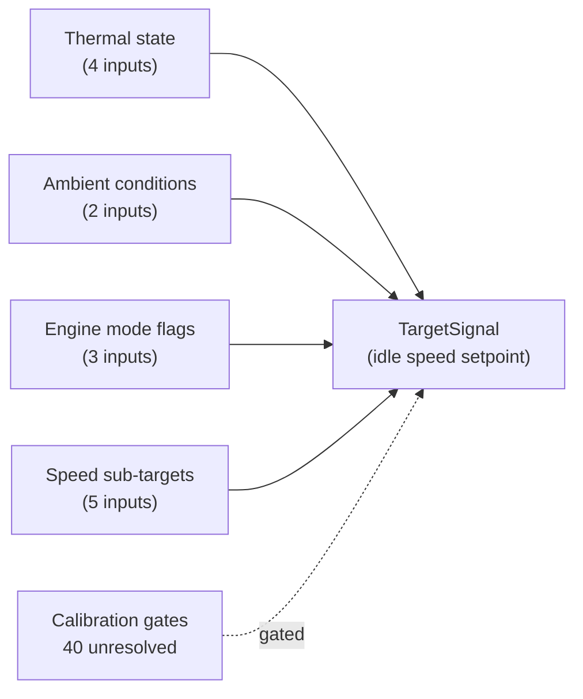

# Automotive Signal Trace Report

## What This Skill Does

Convert signal backtrace analysis into an engineering deliverable. The audience is a calibration engineer or software integrator who needs to understand: what feeds this signal, which conditions gate it, which subsystems are involved, and what needs follow-up.

A report that lists tables and counts is not a deliverable. A report that interprets findings, groups them by engineering significance, and recommends concrete next steps is.

---

## Generate the Raw Data

```bash
# Produce the human report and CSV exports
python3 scripts/automotive/signal_trace_report.py \
  --input results/trace.json \
  --output results/trace_report.md \
  --title "Signal Name — Depth-N Backtrace" \
  --agent-comment "Your domain interpretation here."

# Combined multi-trace report
python3 scripts/automotive/signal_trace_report.py \
  --input results/trace_depth2.json \
  --input results/trace_FID_depth1.json \
  --output results/final_report.md \
  --export-dir results/tables \
  --title "Signal Name — Final Trace Report"
```

The script produces Markdown tables and CSV exports. **These are the raw material, not the report.** The engineering report is built on top of them.

---

## Report Structure

Produce sections in this order. Every section requires engineering interpretation, not just data repetition.

---

### Section 1: Executive Summary (required)

One paragraph. Must answer all four questions:
1. What does the traced signal represent in ECU behavior?
2. How many evidence-backed routes were found, and what does that count suggest about the signal's architectural complexity?
3. What was the dominant reason routes were not followed (depth limit, calibration gate, filter)?
4. What is the single most important open question?

Example:
> `SpdIdlEng_nBasStat_VW` is the static base engine idle speed setpoint, computed by the idle speed control function from 19 direct inputs including engine temperature, state flags, and region-specific speed sub-targets. The depth-2 trace followed 450 evidence-backed routes across 277 nodes, indicating this is a deeply integrated function at the center of powertrain coordination. 1390 depth-limited candidates remain unexplored. The primary open question is whether the 40 calibration gates in the `DATA_SpdIdlEng` namespace are active in this calibration dataset, which requires domain review of condition semantics.

---

### Section 2: Trace Parameters

Short table only — not a section for interpretation:

| Parameter | Value |
|-----------|-------|
| Signal | name |
| Depth | N |
| Group filter | FID / MIL / none |
| A2L file | filename only |
| HEX file | filename only |
| EHB file(s) | filename only |
| Followed edges | N |
| Skipped routes | N |
| Calibration decisions | N |
| EHB evidence entries | N |

---

### Section 3: Signal Identity

What is this signal? Use the A2L description and EHB DITA plain-English text to produce:

- **Physical quantity:** What does this value represent? (speed in RPM, temperature in °C, boolean flag, state machine index)
- **Owner function:** Which FUNCTION block computes or arbitrates this signal?
- **Role:** Is it a final output, an intermediate arbitration result, or a sub-target?
- **Naming decode:** Apply the naming convention analysis from `automotive-signal-backtrace` — what do the prefix, infix, and suffix tell you?

---

### Section 4: Direct Input Analysis

Do not list all N direct inputs as a table. Group them by subsystem prefix and write one paragraph per group:

**Format:**
> **[Module group name] (`Prefix_`)** — N inputs
> [One to two sentences on what this group of signals represents and why it contributes to the target signal's computation.]

Example:
> **Engine Temperature and Thermal State (`Eng_`, `EngDa_`)** — 4 inputs
> Engine coolant temperature, oil temperature, downstream coolant temperature, and post-start timer. These govern idle speed warmup enrichment — cold start requires higher idle to avoid stalling and accelerate catalyst light-off.

> **Ambient Conditions (`GlbDa_`)** — 2 inputs
> Ambient temperature and ambient pressure. Used to compensate idle speed for altitude and cold ambient operation.

After the groups, write a one-line synthesis: *"Direct inputs are consistent with a classical multi-condition idle speed arbitration: thermal state, ambient conditions, engine mode flags, and region-specific sub-targets all contribute."*

---

### Section 5: Calibration Gate Analysis

Do not list all 40 calibrations row by row. Analyze them:

**5.1 — Namespace grouping**
Group by DATA namespace prefix (e.g., all `DATA_SpdIdlEng.*` together). Name each group and explain what type of calibration it represents.

**5.2 — Calibration type breakdown**
Within each group, count:
- Constants (`_C_VW`) — single-value gates, mode selectors.
- Maps/tables (`_M_VW`, `_T_VW`) — lookup tables, likely determining a speed setpoint from a temperature or load condition.
- Arrays (`_A_VW`) — multi-element parameters.

**5.3 — Raw byte observations**
For any calibration with resolved HEX bytes, report the raw value and what it may indicate:
> `DATA_SpdIdlEng.SpdIdlEng_nEngIni_C_VW` at `0x80358E90`: raw byte `0x28` (decimal 40). Without conversion metadata, a precise RPM value cannot be claimed. If this is a speed offset in a 1-LSB = 1 RPM scheme, this would represent a 40 RPM positive offset — plausible for a cold-start initialization bump.

State clearly which calibrations had missing metadata (address not found, or HEX bytes not present).

**5.4 — What needs follow-up**
Name specifically which calibrations need domain review and why:
> The `SpdIdlEng_st_C_VW` and `SpdIdlEng_stEngRun_C_VW` constants (raw: `0x02`, `0x03`) suggest mode or state selection. These should be confirmed against the EHB function documentation to determine whether they represent an active mode gate.

---

### Section 6: Architecture Observations

Interpret the shape of the graph:

- **Depth ratio:** Ratio of depth-2 edges to depth-1 edges (e.g., 431 vs 19) tells you how much of the complexity is two hops away. A high ratio means the direct callers are themselves complex aggregators.
- **Top contributor families at depth 2:** The top 5 source families from the report script. Name them and explain what they represent.
- **Cross-module dependencies from EHB:** Which modules appear in EHB evidence that are not obvious from A2L function names? These are architectural dependencies invisible from calibration alone.
- **Depth completeness:** If 1390 candidates are depth-limited, state what that implies — *"Inspecting to depth 3 would likely expand into most of the powertrain function hierarchy. A targeted sub-trace on a specific intermediate signal is more useful than a blind depth increase."*

---

### Section 7: Group Filter Analysis (if applicable)

If a FID or MIL filter was run:

State the engineering conclusion first, then the evidence:

> **FID filter result: no direct FID-related dependency at depth 1.**
>
> The FID-filtered trace followed 0 routes and skipped 57. Of the 57 skipped routes, all were filtered (not depth-limited or calibration-gated). This confirms that `SpdIdlEng_nBasStat_VW`'s direct depth-1 inputs do not include FID monitor signals. The signal's idle speed computation is not directly inhibited by a functional identifier gate at this depth — FID influence, if present, would be indirect through a depth-2 or deeper intermediate.

---

### Section 8: Open Questions and Next Steps

Make these actionable. Each item should name a specific signal, calibration, or module:

**Format:**
> **[Priority: High/Medium/Low]** — [Specific action and why]

Example:
> **High** — Confirm condition semantics for `DATA_SpdIdlEng.SpdIdlEng_st_C_VW` (raw `0x02`) and `SpdIdlEng_stEngRun_C_VW` (raw `0x03`). These look like state/mode selector constants. If either gates route expansion, the unresolved count drops and the trace becomes more conclusive.

> **Medium** — Run a focused depth-2 backtrace starting from `ChaDiag_stPrfVarPtAct_VW` (87 direct inputs at depth 2). This is the largest single contributor sub-graph and warrants its own analysis.

> **Low** — Check the `SpdIdlEng` EHB DITA topics for the `SpdIdlEng_nBasStat_VW` function block description. This may clarify which of the 19 direct inputs are primary (active in all conditions) vs conditional (only in specific modes).

---

### Section 9: Summary Mermaid Diagram

Include one compact diagram showing only depth-1 direct inputs grouped by subsystem, not the full edge list. The purpose is visual orientation for a reader who will not read all 450 edges.



---

### Section 10: Full Data Exports

List the CSV files generated by the script:

| File | Rows | Content |
|------|------|---------|
| `followed_routes.csv` | N | All followed edges with evidence |
| `skipped_routes.csv` | N | All skipped routes with reason |
| `calibration_decisions.csv` | N | All calibration resolutions with raw bytes |
| `nodes.csv` | N | All graph nodes |
| `evidence.csv` | N | All EHB evidence matches |

State: *"These files are the complete record. The report above explains what they mean — open the CSV files for full row-level data."*

---

## What NOT to Do

- Do not paste a 450-row table into the report. The CSV file exists for that.
- Do not repeat the same data table three times with slightly different columns.
- Do not call a calibration "disabled" unless the condition semantics are confirmed.
- Do not write "N routes were skipped" without explaining which skip category dominates and what it means.
- Do not end the report without concrete next steps that name specific signals or calibrations.
- Do not write the EHB evidence section as a list of entry paths — interpret what the entries say.
